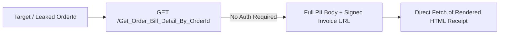
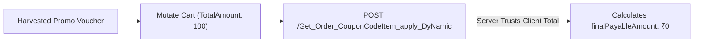
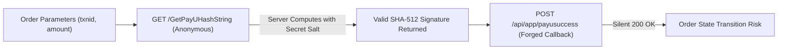

# Security Analysis of an Enterprise Food & Beverage Mobile Ordering Platform

[](#coordinated-disclosure--timeline)
[](#findings-summary)
[](#scope--safe-methodology)

> **Disclaimer:** This case study is published strictly for defensive engineering and educational purposes. All vendor marks, proprietary APIs, hostnames, promotional codes, and database identifiers have been sanitized or replaced with synthetic representations. Disclosed vulnerabilities have undergone coordinated disclosure and remediation.

---

## Executive Summary

Modern mobile food and beverage ordering platforms operate at the intersection of consumer mobile applications, cloud API backends, point-of-sale (POS) systems, and third-party payment gateways. While these architectures deliver seamless consumer experiences—such as rapid mobile ordering, dynamic loyalty discounts, and digital receipts—they frequently introduce critical business logic and authorization flaws.

This repository details a real-world, black-box security evaluation of a commercial food and beverage mobile ordering platform. Key findings include:
- **Unauthenticated BOLA / IDOR:** Complete customer order records, personal delivery addresses, and live tax invoices accessible without authentication.
- **Client-Controlled Pricing Logic:** Server computing flat promotional discounts directly against client-asserted cart totals, yielding ₹0 payable carts.
- **Voucher Enumeration via Error Oracle:** A 3-state error response oracle enabling systematic harvesting of high-value campaign vouchers across a low-entropy namespace.
- **Payment Verification Primitives:** An unauthenticated salted SHA-512 signing oracle paired with silent payment callback ingestion.
- **Insecure Session Lifecycles:** 2-year JWT validity with decorative, unenforced session cookies.

---

## System Architecture

```
┌────────────────────────────────────────────────────────┐
│               Android Client Application               │
│  • React Native Framework                              │
│  • Hermes JavaScript Engine (Bytecode v98)             │
│  • OkHttp 4.12.0 Network Stack                         │
└──────────────┬─────────────────────────┬───────────────┘
               │                         │
      REST API │ (HTTPS)                 │ WebViews / SDKs
               ▼                         ▼
┌──────────────────────────────┐ ┌───────────────────────┐
│     Cloud Backend API        │ │ Third-Party Services  │
│  • ASP.NET / IIS 10.0 Web API│ │  • Hosted Payment GWs │
│  • Microsoft SQL Server DB   │ │    (Razorpay, PayU,   │
│  • HS256 Bearer JWT Auth     │ │     Juspay HyperSDK)  │
│  • JSON Serialization Layer  │ │  • Cloud POS Invoicing│
└──────────────────────────────┘ └───────────────────────┘
```

---

## Scope & Safe Methodology

All testing adhered strictly to non-destructive boundaries and ethical guidelines:
- **Positive Controls Only:** Authorization bypass (BOLA/IDOR) tests were conducted exclusively using the researcher's own user accounts and self-funded orders. Zero third-party customer data was accessed or retained.
- **No Downstream Ledger Tampering:** Price manipulation and payment callback vulnerabilities were evaluated strictly on pre-order validation layers; final order placement was intentionally halted.
- **Controlled Pacing:** Fuzzing and verification sweeps incorporated artificial delays to prevent server resource exhaustion.

---

## Findings Summary

| ID | Finding | Severity | CWE | OWASP Top 10 | Key Impact / Status |
| :--- | :--- | :---: | :--- | :--- | :--- |
| **[F-01](./findings/01-broken-object-level-authorization-order-pii.md)** | **Broken Object-Level Authorization on Order APIs** | **High** (7.5) | CWE-639<br>CWE-200 | API1:2023 BOLA<br>MASVS-AUTH | Complete customer PII & live invoices fetchable anonymously via OrderId GUID. |
| **[F-02](./findings/02-client-side-cart-total-trust.md)** | **Client-Controlled Pricing in Cart Validation** | **High** (7.5) | CWE-807<br>CWE-472 | Business Logic<br>MASVS-CODE | Server computes discounts against client-asserted `TotalAmount`, yielding ₹0 carts. |
| **[F-03](./findings/03-promotion-abuse-enumeration.md)** | **Voucher Enumeration via 3-State Error Oracle** | **High** (7.3) | CWE-807<br>CWE-837 | API4:2023 Resource | 3-state oracle enables systematic harvesting of high-value campaign vouchers. |
| **[F-04](./findings/04-long-lived-tokens.md)** | **2-Year JWTs & Decorative Session Cookies** | **Medium** (5.3) | CWE-613<br>CWE-287 | API2:2023 Auth<br>MASVS-AUTH | 730-day token lifespan without refresh rotation; cookies ignored by backend. |
| **[F-05](./findings/05-payment-callback-and-hash-oracle.md)** | **Payment Hash Oracle & Silent Callbacks** | **Medium** (6.5) | CWE-807<br>CWE-798 | Business Logic<br>MASVS-CRYPTO | Unauthenticated SHA-512 signing oracle paired with unverified 200 OK callbacks. |
| **[F-06](./findings/06-sensitive-data-in-urls-and-verbose-errors.md)** | **PII in URLs, Exception Leaks & Catalog Scrapes** | **Low** (4.3) | CWE-200<br>CWE-209 | MASVS-CODE<br>MASVS-STORAGE | Mobile numbers in GET queries; verbose SQL Server exceptions disclosed to client. |

---

## Attack Chain Highlights

### 1. Anonymous PII & Invoice Harvesting (F-01)

*Anonymous callers providing an `OrderId` GUID receive the exact same byte-for-byte response as the authenticated owner, disclosing customer names, phone numbers, delivery addresses, and unexpired signed invoice links.*

### 2. Arbitrary Cart Price Reduction (F-02 + F-03)

*By submitting a valid line item alongside an artificially suppressed `TotalAmount: 100`, the server passes its minimum threshold check and applies a flat promotional discount directly against the client-asserted total.*

### 3. Payment Callback & Signature Forgery Primitive (F-05)

*An unauthenticated cryptographic hash oracle allows arbitrary payment strings to be signed with the server's confidential merchant salt, while callback routes ingest notifications without out-of-band verification.*

---

## Core Remediation Blueprint

```
┌────────────────────────────────────────────────────────────────────────┐
│                   Zero-Trust API Architecture Blueprint                │
└───────────────────────────────────┬────────────────────────────────────┘
                                    │
    ┌───────────────────────────────┼───────────────────────────────┐
    ▼                               ▼                               ▼
[Authorization Layer]     [Catalog Pricing Engine]     [Cryptographic Services]
• Mandatory JWT auth       • Server is sole authority   • Deprecate client hash
• Caller uid binding       • Authoritative DB prices      oracles
• Uniform 404 responses    • Recompute at checkout      • Out-of-band payment
  (no existence oracles)   • Strict stock/qty limits      reconciliation
```

1. **Zero-Trust Access Control:** Enforce global `[Authorize]` middleware on all order routes. Verify that `Order.CustomerId == Token.uid`, returning uniform HTTP 404s for nonexistent and unauthorized records alike.
2. **Authoritative Pricing:** Prohibit client-submitted prices and totals. Clients submit only `itemId` and `qty`; all pricing, discounts, and tax computations must occur strictly from server-side database catalog lookups.
3. **Uniform Promotional Oracles:** Eliminate multi-state error leaks by returning identical error schemas and status codes across invalid, expired, and nonexistent promotional vouchers. Rate-limit validation attempts.
4. **Out-of-Band Payment Reconciliation:** Never transition order payment status based solely on incoming webhook POST bodies. Always perform direct server-to-server transaction status queries against payment gateway APIs.
5. **Modern Session Lifecycles:** Decouple sessions into short-lived access tokens (15 minutes) and rotating, hardware-backed refresh tokens, with server-side revocation enabled via user `token_version` tracking.

---

## Coordinated Disclosure & Timeline

- **Phase 1 (Discovery & Analysis):** Vulnerabilities identified during passive traffic inspection and positive-control testing.
- **Phase 2 (Positive Control Verification):** Empirical validation completed exclusively on researcher-owned accounts and orders.
- **Phase 3 (Disclosure & Remediation):** Comprehensive disclosure evidence compiled; server-side invalidation and remediation deployed by the vendor.
- **Phase 4 (Public Release):** Published following confirmed vendor remediation and expiration of the agreed coordinated disclosure window.

---

## Repository Index

- [`findings/01-broken-object-level-authorization-order-pii.md`](./findings/01-broken-object-level-authorization-order-pii.md)
- [`findings/02-client-side-cart-total-trust.md`](./findings/02-client-side-cart-total-trust.md)
- [`findings/03-promotion-abuse-enumeration.md`](./findings/03-promotion-abuse-enumeration.md)
- [`findings/04-long-lived-tokens.md`](./findings/04-long-lived-tokens.md)
- [`findings/05-payment-callback-and-hash-oracle.md`](./findings/05-payment-callback-and-hash-oracle.md)
- [`findings/06-sensitive-data-in-urls-and-verbose-errors.md`](./findings/06-sensitive-data-in-urls-and-verbose-errors.md)
