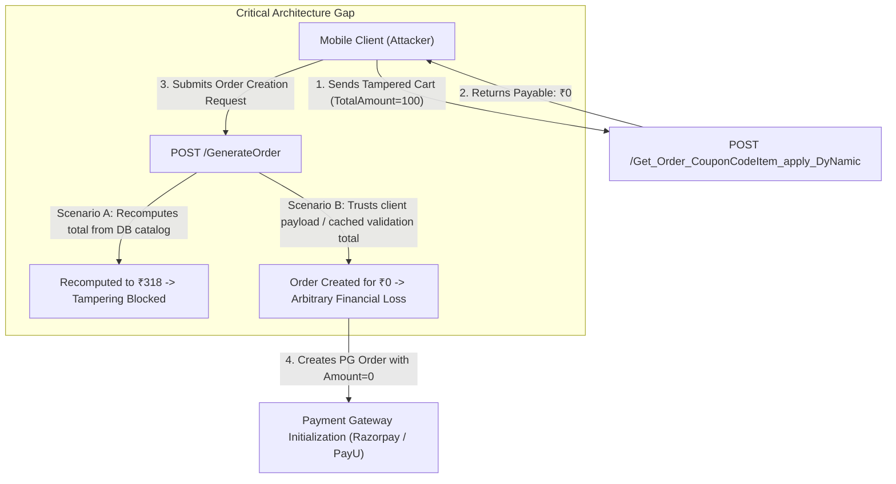

# 02 — Server Trusts Client-Supplied Cart Totals and Pricing During Coupon Application

**Severity:** High · **CVSS v3.1:** 7.5 (`CVSS:3.1/AV:N/AC:L/PR:N/UI:N/S:U/C:N/I:H/A:N`)
**CWE:** CWE-807 (Reliance on Untrusted Inputs in a Security Decision), CWE-472 (Impending Price Calculation)
**OWASP Categories:** Business Logic Abuse, OWASP MASVS-CODE

> **Anonymized, educational case study.** No real hostnames, active promo codes, or proprietary API contracts are included. All snippets, requests, and schemas are synthetic illustrations derived from verified live-traffic telemetry.

---

## 1. Executive Summary

During an assessment of the platform's mobile API, a critical business logic flaw was identified in the promotional coupon validation endpoint (`/api/app/Get_Order_CouponCodeItem_apply_DyNamic`). The endpoint accepts a client-constructed shopping cart containing item prices, addon prices, item quantities, and overall cart totals (`TotalAmount`), and computes discount values directly against the **client-asserted total** without validating against the authoritative database catalog.

When combined with flat-rate discount vouchers, an attacker can manipulate line-item prices, inject negative addon amounts, or directly override the single `TotalAmount` field to reduce the calculated `finalPayableAmount` to **₹0**. 

The only server-side validation observed was a coarse minimum-cart threshold gate requiring `TotalAmount` to exceed approximately ~95. Setting `TotalAmount: 100` satisfies the gate, floors the flat discount at ₹100, and returns a calculated payable amount of zero.

---

## 2. Vulnerability Mechanics & API Anatomy

The target endpoint calculates applicable promotional discounts prior to order creation:

```http
POST /api/app/Get_Order_CouponCodeItem_apply_DyNamic HTTP/1.1
Host: app.foodbev.invalid
Authorization: Bearer <VALID_CUSTOMER_JWT>
Content-Type: application/json

{
  "CouponCode": "CAMPAIGN247",
  "TotalAmount": 318,
  "TotalQty": 1,
  "ItemList": [
    {
      "itemId": "item-1001-xxxx-xxxx-xxxx-xxxxxxxxxxxx",
      "sku": "1001",
      "price": 207,
      "groupPrice": 207,
      "offerPrice": 207,
      "qty": 1,
      "outOfStock": false,
      "itemInStock": true,
      "optionDetails": [
        {
          "optionItemId": "opt-01",
          "price": 61,
          "isDefault": true,
          "optionItemOutOfStock": false
        },
        {
          "optionItemId": "opt-02",
          "price": 50,
          "isDefault": true,
          "optionItemOutOfStock": false
        }
      ]
    }
  ]
}
```

### The Insecure Trust Model
1. **Client as Catalog Authority:** The server expects the mobile client to provide the item prices, addon prices, and aggregated totals. The backend does not perform a database lookup to retrieve canonical unit prices.
2. **Total Echoing:** The server blindly reflects the incoming `TotalAmount` into the response's `totalCartPriceStr` field.
3. **Discount Math Abuse:** In the case of flat discount coupons (e.g., a promotional voucher offering ₹247 off), the backend implements the following logic:
   $$\text{discount} = \min(\text{FlatDiscountAmount}, \text{TotalAmount})$$
   $$\text{finalPayableAmount} = \max(0, \text{TotalAmount} - \text{discount})$$
4. **The Zero-Payable Exploitation:** If the attacker submits a valid line item but overrides `TotalAmount: 100`, the server computes:
   $$\text{discount} = \min(247, 100) = 100$$
   $$\text{finalPayableAmount} = 100 - 100 = 0$$

---

## 3. Empirical Fuzzing & Replay Matrix

A controlled live fuzzing suite consisting of 37 distinct payload variations was executed against the validation endpoint. Across all requests, no rate limiting (`429 Too Many Requests`) or account lockout was triggered.

| Test ID | Mutation Description | Payload Modifications | Observed Server Response | Security Finding |
| :--- | :--- | :--- | :--- | :--- |
| **T01** | Baseline Request | Original cart: ₹207 base + ₹61 + ₹50 addons = ₹318. | `totalCartPriceStr: 318`<br>`totalDiscountPriceStr: 247`<br>`finalPayableAmount: 71` | Baseline control: 77.7% discount. |
| **T02** | Base Price Override | Set `price: 1`, `groupPrice: 1`, `TotalAmount: 112`. | `totalCartPriceStr: 112`<br>`finalPayableAmount: 0` | Server trusts tampered item unit price. |
| **T03** | Gate Boundary (< 95) | Set `TotalAmount: 95` (and 0, 1, 50, 75, 90). | HTTP 200, `success: false`<br>`"Invalid cart amount, it should be more than 100"` | Identifies the minimum cart threshold gate (~95). |
| **T04** | Gate Boundary (100) | Set `TotalAmount: 100` on single valid item. | HTTP 200, `success: true`<br>`finalPayableAmount: 0` | **Threshold satisfied; cart evaluated to payable ₹0.** |
| **T05** | Negative Addon Price | Injected addon `price: -99`, `TotalAmount: 219`. | HTTP 200, `success: true`<br>`totalCartPriceStr: 219` | Backend accepts negative numbers without range validation. |
| **T06** | Out-of-Stock Selection | Set `isDefault: true` on option with `optionItemOutOfStock: true`. | HTTP 200, `success: true`<br>Full discount applied | Server does not enforce real-time inventory on option items. |
| **T07** | Quantity Decoupling | Modified `qty: 5`, left `TotalAmount: 318`. | HTTP 200, `success: true`<br>`unitPrice: 207` | Quantity not multiplied against item price; server ignored line qty. |
| **T08** | Mismatched Total | Sum of items = ₹318; submitted `TotalAmount: 300`. | HTTP 200, `success: true`<br>`totalCartPriceStr: 300`<br>`finalPayableAmount: 53` | Server ignores line items entirely and uses header total. |

---

## 4. Architectural Impact: The Validation vs Checkout Gap

In modern e-commerce and ordering applications, the coupon validation endpoint is a pre-order step. Security risk depends heavily on how the downstream order-creation and payment-initialization services are implemented:



1. **Scenario A (Server-Side Canonical Truth):** If the subsequent `GenerateOrder` endpoint completely discards client totals and independently calculates line-item prices, stock availability, and coupon rules from the database catalog, the tampering remains localized to client-side presentation.
2. **Scenario B (Trust Propagation):** If `GenerateOrder` trusts the client-supplied cart object or reuses the calculation state produced by the coupon application endpoint (e.g., passing `finalPayableAmount` directly to initialize the payment gateway order ID via `razorpayGeneratedOrderId`), an attacker achieves **complete financial fraud**, acquiring commercial products at zero cost.

---

## 5. Technical Root Cause Analysis

The root cause is an anti-pattern common in mobile API backends where the server delegates cart calculations to the client app to simplify mobile frontend state synchronization, treating the incoming JSON payload as trusted domain entities.

### Vulnerable Server Implementation (Illustrative C# / ASP.NET)

```csharp
// VULNERABLE CONTROLLER LOGIC
[HttpPost("Get_Order_CouponCodeItem_apply_DyNamic")]
public async Task<IActionResult> ApplyCoupon([FromBody] CouponApplyRequest request)
{
    // ANTI-PATTERN: Blindly trust client-supplied total
    decimal cartTotal = request.TotalAmount;

    // Minimum cart gate check only
    if (cartTotal <= 95)
    {
        return Ok(new { success = false, message = "Invalid cart amount, it should be more than 100" });
    }

    var coupon = await _db.Coupons.FirstOrDefaultAsync(c => c.Code == request.CouponCode);
    if (coupon == null)
    {
        return Ok(new { success = false, message = "Invalid coupon" });
    }

    // Flat discount calculation against attacker-controlled cartTotal
    decimal discount = Math.Min(coupon.FlatAmount, cartTotal);
    decimal payable = Math.Max(0, cartTotal - discount);

    return Ok(new
    {
        success = true,
        obj_CouponCode = new
        {
            totalCartPriceStr = cartTotal.ToString("F0"),
            totalDiscountPriceStr = discount.ToString("F0"),
            finalPayableAmount = payable.ToString("F0")
        }
    });
}
```

---

## 6. Remediation & Fixed Pattern

Secure pricing systems must enforce that **the server is the sole source of pricing truth**:

1. **Never Accept Prices from the Client:** The client should submit only item identifiers (`itemId`), variant IDs (`optionItemId`), and desired quantities (`qty`). The server must look up prices exclusively from the database catalog.
2. **Strict Addon and Hierarchy Validation:** Ensure that each submitted `optionItemId` is an active, valid addon specifically configured for the parent `itemId`.
3. **Inventory & Stock Enforcement:** Cross-check real-time inventory balances; reject items or variants marked out of stock.
4. **Mandatory End-to-End Re-validation:** Repeat the exact same catalog recomputation at:
   - The coupon application endpoint.
   - The final `GenerateOrder` endpoint.
   - The payment gateway order creation step (the amount passed to Razorpay / PayU / Juspay must originate from the server-computed database total).

### Fixed Server Implementation (Illustrative C#)

```csharp
// SECURE SERVER-SIDE PRICING ENGINE
[HttpPost("Get_Order_CouponCodeItem_apply_DyNamic")]
public async Task<IActionResult> ApplyCouponSecure([FromBody] SecureCouponApplyRequest request)
{
    if (request.Items == null || !request.Items.Any())
    {
        return BadRequest(new { success = false, message = "Cart cannot be empty." });
    }

    // 1. Fetch canonical catalog items from DB using submitted item IDs
    var itemIds = request.Items.Select(i => i.ItemId).Distinct().ToList();
    var catalogItems = await _db.CatalogItems
        .Include(c => c.ValidOptions)
        .Where(c => itemIds.Contains(c.Id) && c.IsActive)
        .ToDictionaryAsync(c => c.Id);

    decimal authoritativeCartTotal = 0;

    // 2. Authoritative line-by-line price calculation
    foreach (var lineItem in request.Items)
    {
        if (!catalogItems.TryGetValue(lineItem.ItemId, out var catalogItem))
        {
            return BadRequest(new { success = false, message = $"Item {lineItem.ItemId} is invalid or inactive." });
        }

        if (catalogItem.IsOutOfStock)
        {
            return BadRequest(new { success = false, message = $"Item '{catalogItem.Name}' is out of stock." });
        }

        if (lineItem.Qty <= 0 || lineItem.Qty > 10) // Enforce strict quantity bounds
        {
            return BadRequest(new { success = false, message = "Invalid quantity specified." });
        }

        decimal lineItemTotal = catalogItem.BasePrice;

        // Validate nested option items
        foreach (var optId in lineItem.SelectedOptionIds)
        {
            var option = catalogItem.ValidOptions.FirstOrDefault(o => o.Id == optId);
            if (option == null || option.IsOutOfStock)
            {
                return BadRequest(new { success = false, message = $"Option {optId} is invalid or out of stock." });
            }
            lineItemTotal += option.AdditionalPrice;
        }

        authoritativeCartTotal += (lineItemTotal * lineItem.Qty);
    }

    // 3. Enforce business thresholds against server-computed total
    if (authoritativeCartTotal < 100)
    {
        return Ok(new { success = false, message = "Cart total does not satisfy minimum order threshold of ₹100." });
    }

    // 4. Validate coupon eligibility against authoritative total
    var coupon = await _db.Coupons.FirstOrDefaultAsync(c => c.Code == request.CouponCode && c.IsActive);
    if (coupon == null)
    {
        return Ok(new { success = false, message = "Invalid or expired promotional code." });
    }

    decimal discount = Math.Min(coupon.FlatAmount, authoritativeCartTotal);
    decimal payable = authoritativeCartTotal - discount;

    return Ok(new
    {
        success = true,
        obj_CouponCode = new
        {
            totalCartPriceStr = authoritativeCartTotal.ToString("F2"),
            totalDiscountPriceStr = discount.ToString("F2"),
            finalPayableAmount = payable.ToString("F2")
        }
    });
}
```

---

## 7. Verification & Defensive Testing

### Automated Abuse-Case Unit Test
```csharp
[Fact]
public async Task ApplyCoupon_WhenClientTamperedTotalSent_IgnoresClientTotalAndComputesFromDB()
{
    // Arrange: Item in DB is ₹200. Attacker claims price is ₹1 and TotalAmount is ₹100.
    var client = Factory.CreateAuthenticatedClient();
    var payload = new
    {
        CouponCode = "FLAT200",
        TotalAmount = 100, // Tampered
        ItemList = new[]
        {
            new { itemId = KnownDbItem.Id, price = 1, qty = 1 } // Tampered price
        }
    };

    // Act
    var response = await client.PostAsJsonAsync("/api/app/Get_Order_CouponCodeItem_apply_DyNamic", payload);
    var content = await response.Content.ReadFromJsonAsync<CouponResponse>();

    // Assert: Server MUST compute based on DB price (₹200), not tampered ₹100
    Assert.True(content.Success);
    Assert.Equal("200.00", content.Obj_CouponCode.TotalCartPriceStr);
}
```

### Static Analysis Code Audit Grep
```bash
# Grep for controller endpoints directly referencing TotalAmount or CartPrice from request models
grep -rn "request\.TotalAmount" src/Controllers/
grep -rn "req\.body\.TotalAmount" src/api/
```
