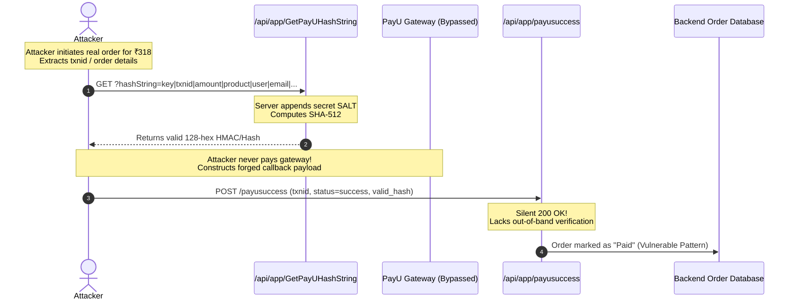

# 05 — Payment Callback Handling and Unauthenticated Cryptographic Hash Oracle

**Severity:** Medium (High Primitive) · **CVSS v3.1:** 6.5 (`CVSS:3.1/AV:N/AC:H/PR:N/UI:N/S:U/C:L/I:H/A:N`)
**CWE:** CWE-807 (Reliance on Untrusted Inputs in a Security Decision), CWE-798 (Use of Hard-coded Credentials / Salts), CWE-862 (Missing Authorization)
**OWASP Categories:** Business Logic Abuse, OWASP MASVS-CRYPTO, OWASP MASVS-CODE

> **Anonymized, educational case study.** No live merchant keys, cryptographic salts, production transaction IDs, or gateway credentials are included. All snippets, workflows, and code blocks are synthetic illustrations based on verified architectural observations.

---

## 1. Executive Summary

During an assessment of the mobile application's checkout and payment gateway integrations, an architectural weakness was identified in the payment processing subsystem. The application integrates multiple third-party payment service providers (PSPs)—specifically Razorpay, PayU, and Juspay HyperSDK.

Two distinct security defects were confirmed in the PayU integration layer:
1. **Unauthenticated Cryptographic Hash Oracle:** An unauthenticated API endpoint (`/api/app/GetPayUHashString`) accepts arbitrary string inputs and returns a valid salted SHA-512 hash computed using the server's secret merchant salt. This allows any external attacker to generate authentic payment signatures without possessing the confidential merchant key.
2. **Silent Callback Ingestion:** The payment callback endpoints (`/api/app/payusuccess` and `/api/app/payufailed`) silently return HTTP 200 OK with empty bodies when presented with empty, malformed, or forged payment notification payloads.

When chained together, an attacker holding a valid order ID can mint a cryptographically valid transaction hash via the oracle and transmit it to the callback endpoint. If the backend fails to perform out-of-band server-to-server transaction status reconciliation with the payment gateway, orders can be transitioned to "Paid" status fraudulently.

---

## 2. Payment Architecture & Gateway Integration

Static reverse engineering of the Android client (Hermes JavaScript bytecode bundles and decompiled Java classes) alongside network captures revealed a multi-provider payment architecture:

```
┌────────────────────────────────────────────────────────┐
│                      Mobile Client                     │
└──────────────┬─────────────────────────┬───────────────┘
               │                         │
     1. Fetches Config            3. Hosted Checkout
               ▼                         ▼
┌──────────────────────────────┐ ┌───────────────────────┐
│     Backend Services         │ │   Payment Gateways    │
│  /GetStoreWiseCharges        │ │  • Razorpay SDK       │
│  • selectedPG                │ │  • PayU SDK           │
│  • successURL=/payusuccess   │ │  • Juspay HyperSDK    │
│  • failedURL=/payufailed     │ └───────────┬───────────┘
└──────────────┬───────────────┘             │
               │                             │
               │   4. Server Callback (POST) │
               └─────────────────────────────┘
```

1. **Dynamic Gateway Selection:** The endpoint `GET /api/app/GetStoreWiseCharges?StoreCode=` returns the active payment provider for the target outlet (`selectedPG`), along with explicit callback paths:
   - `successURL = "/api/app/payusuccess"`
   - `failedURL = "/api/app/payufailed"`
2. **Envelope Instrumentation:** Standard API response envelopes include telemetry and state fields:
   - `razorpayGeneratedOrderId`: Server-minted Razorpay order identifier (populated during checkout).
   - `juspayPayload`: Juspay session metadata.
3. **Third-Party Telemetry:** Network traffic captured background analytics sent to `logs.juspay.invalid` (`/godel/analytics`), indicating client-side gateway telemetry.

---

## 3. The Unauthenticated Salted-SHA-512 Hash Oracle

PayU payment integrations rely on a cryptographic SHA-512 checksum string to guarantee the integrity of transaction parameters:

$$\mathbf{PayU\ Hash\ Format:} \quad \text{SHA512}(\texttt{key}|\texttt{txnid}|\texttt{amount}|\texttt{productinfo}|\texttt{firstname}|\texttt{email}|\dots|\texttt{SALT})$$

To complete transactions, the payment client requires this hash. However, rather than generating the hash strictly within an authenticated, order-scoped server checkout session, the backend exposed a dedicated standalone hash generation endpoint:

```http
GET /api/app/GetPayUHashString?hashString=TESTPAYLOAD HTTP/1.1
Host: app.foodbev.invalid
```

*(Note: In the assessed environment, the endpoint was route-mapped as `GetPayUHashString` with a minor typographical variant in backend routes).*

### Empirical Findings
- **No Authentication Required:** The endpoint is completely accessible to anonymous callers. Requests omitting `Authorization: Bearer` and cookies succeed with HTTP 200 OK.
- **Arbitrary String Acceptance:** The `hashString` parameter accepts arbitrary client-defined text.
- **Cryptographic Oracle Behavior:**
  1. **Deterministic:** Querying the same `hashString` repeatedly yields the exact same 128-character hexadecimal string.
  2. **Input Sensitivity:** Modifying a single character produces an entirely uncorrelated 128-character output, consistent with cryptographic hashing.
  3. **Salt Mixing Confirmed:** Comparing the API output against a locally computed $\text{SHA-512}(\texttt{"TESTPAYLOAD"})$ confirmed that the values **do not match**. The backend automatically concatenates or interleaves the confidential server-side merchant salt.
- **Security Impact:** The endpoint acts as an open signing oracle. Anyone on the internet can supply custom transaction parameters and receive a cryptographically valid PayU hash without possessing the secret merchant salt.

---

## 4. Silent Payment Callback Handling

Live probes were conducted against the registered callback endpoints on the production backend:

| Probe Method | Target Endpoint | Submitted Payload | Observed Server Response | Behavioral Analysis |
| :--- | :--- | :--- | :--- | :--- |
| `GET` | `/api/app/payusuccess` | N/A | HTTP 405 Method Not Allowed | Confirms route exists and is POST-only. |
| `POST` | `/api/app/payusuccess` | `{}` (Empty JSON) | **HTTP 200 OK** (Empty body) | Silent acceptance; no schema validation error. |
| `POST` | `/api/app/payufailed` | `{}` (Empty JSON) | **HTTP 200 OK** (Empty body) | Silent acceptance; no schema validation error. |
| `POST` | `/api/app/payusuccess` | `txnid=PROBE1&status=success&hash=invalid` | **HTTP 200 OK** (Empty body) | Forged parameters and invalid signatures accepted without error. |

### The Forgery Threat Chain
When paired with the hash oracle in Section 3, an attacker has all the primitives required to construct a valid payment confirmation:



> [!WARNING]
> While the behavioral primitives (hash oracle and silent 200 response) were confirmed live, verifying whether a forged callback successfully flips an active order to "Paid" in production was deliberately not executed to prevent unauthorized tampering with live production ledgers. This experiment requires isolated staging verification.

---

## 5. Upstream Cart Trust Impact on Razorpay Orders

For gateways where the server creates the order via a backend API (e.g., Razorpay via `razorpayGeneratedOrderId`), the payment gateway cannot be tricked by forged client callbacks because Razorpay verifies payments server-to-server.

However, the gateway order initialization depends directly on the cart pricing engine. As demonstrated in [Finding 02](./02-client-side-cart-total-trust.md), if the pre-order cart calculation endpoint blindly trusts client-supplied totals (`TotalAmount: 100` resulting in payable ₹0), and the server initializes the Razorpay order using this corrupted cart state:
- The Razorpay order is officially minted on Razorpay's infrastructure for **₹0** (or ₹1).
- The user completes payment for ₹0 through official gateway flows.
- The gateway legitimately reports the transaction as fully paid to the backend.

The vulnerability is therefore not a failure of Razorpay's cryptographic verification, but rather **an integrity failure in the upstream application pricing logic**.

---

## 6. Technical Root Cause Analysis

### Vulnerable Server Implementation (Illustrative Python / Flask)

```python
# VULNERABLE PAYMENT IMPLEMENTATION
PAYU_MERCHANT_SALT = "secret_merchant_salt_998877"

# VULNERABILITY 1: Anonymous Hash Minting Oracle
@app.route("/api/app/GetPayUHashString", methods=["GET"])
def get_payu_hash_oracle():
    raw_string = request.args.get("hashString", "")
    # Concatenates server secret and returns hash to unauthenticated caller!
    salted_string = f"{raw_string}|{PAYU_MERCHANT_SALT}"
    computed_hash = hashlib.sha512(salted_string.encode("utf-8")).hexdigest()
    return jsonify(computed_hash), 200

# VULNERABILITY 2: Unvalidated Callback Handler
@app.route("/api/app/payusuccess", methods=["POST"])
def payu_success_callback():
    data = request.form.to_dict() or request.get_json(silent=True) or {}
    txnid = data.get("txnid")

    # Anti-Pattern: Does not verify hash signature
    # Anti-Pattern: Does not call PayU API to verify transaction status out-of-band
    if txnid:
        order = db.orders.find_one({"txnid": txnid})
        if order:
            order["payment_status"] = "PAID"
            db.orders.save(order)

    # Silent 200 OK regardless of payload validity
    return "", 200
```

---

## 7. Remediation & Fixed Pattern

1. **Decommission Anonymous Hash Endpoints:** Immediately delete `/api/app/GetPayUHashString` or restrict it strictly to authenticated, active checkout sessions. The backend must construct the canonical parameter string from its own database records and compute hashes internally; the client should never supply raw strings to be hashed.
2. **Mandatory Server-to-Server Verification:** Never mark an order as paid based solely on incoming HTTP POST callback parameters. When a callback is received:
   - Verify the callback hash signature using a constant-time comparison (`hmac.compare_digest`).
   - Query the payment gateway's server API out-of-band (e.g., PayU `verify_payment` API or Razorpay `orders.fetch`) to confirm the transaction status directly with the provider.
3. **Amount Reconciliation:** Verify that the amount confirmed by the payment gateway matches the server-computed order total to the penny.

### Fixed Server Implementation (Illustrative Python)

```python
# SECURE PAYMENT VERIFICATION ENGINE
import hmac
import hashlib
import requests
from flask import request, abort

PAYU_MERCHANT_KEY = "merchant_key_123"
PAYU_MERCHANT_SALT = "secret_merchant_salt_998877"

@app.route("/api/app/payusuccess", methods=["POST"])
def secure_payment_callback():
    payload = request.form.to_dict()
    txnid = payload.get("txnid")
    received_hash = payload.get("hash", "")
    status = payload.get("status")

    if not txnid or status != "success":
        abort(400, "Invalid transaction parameters.")

    # 1. Constant-time signature verification of callback hash
    # Reverse hash sequence: salt|status|...|key
    expected_sequence = f"{PAYU_MERCHANT_SALT}|{status}|{payload.get('email')}|...|{PAYU_MERCHANT_KEY}"
    calculated_hash = hashlib.sha512(expected_sequence.encode("utf-8")).hexdigest()

    if not hmac.compare_digest(received_hash.lower(), calculated_hash.lower()):
        logger.warning(f"Signature mismatch detected on callback for txnid: {txnid}")
        abort(400, "Cryptographic signature validation failed.")

    # 2. Out-of-band server-to-server reconciliation with gateway API
    gw_response = requests.post(
        "https://info.payu.invalid/merchant/postservice?form=2",
        data={"key": PAYU_MERCHANT_KEY, "command": "verify_payment", "var1": txnid},
        headers={"authorization": PAYU_MERCHANT_SALT},
        timeout=10
    )
    gw_data = gw_response.json()
    txn_details = gw_data.get("transaction_details", {}).get(txnid, {})

    # 3. Assert provider confirms success and amount matches server database truth
    order = db.orders.find_one({"txnid": txnid})
    if not order:
        abort(404, "Order not found.")

    if txn_details.get("status") != "success" or float(txn_details.get("amount", 0)) != float(order["amount_server"]):
        logger.critical(f"Payment reconciliation discrepancy for order {order['id']}")
        order["payment_status"] = "FAILED_VERIFICATION"
        db.orders.save(order)
        abort(400, "Reconciliation failed.")

    # 4. State transition only upon proven reconciliation
    order["payment_status"] = "PAID"
    db.orders.save(order)
    return "", 200
```

---

## 8. Verification & Defender Playbook

### Testing for Silent Callbacks (Curl)
```bash
# Submit malformed POST to callback endpoint
curl -s -o /dev/null -w "%{http_code}\n" -X POST \
  https://app.foodbev.invalid/api/app/payusuccess \
  -H "Content-Type: application/x-www-form-urlencoded" \
  -d "txnid=PROBE_99999&status=success&hash=0000000000000000"

# Target state: Must return HTTP 400 Bad Request, NOT 200 OK.
```

### Static Analysis Code Audit
```bash
# Search for hash calculation endpoints accepting user-defined input
grep -rn "GetPayUHashString" src/
grep -rn "sha512" src/Controllers/
```
